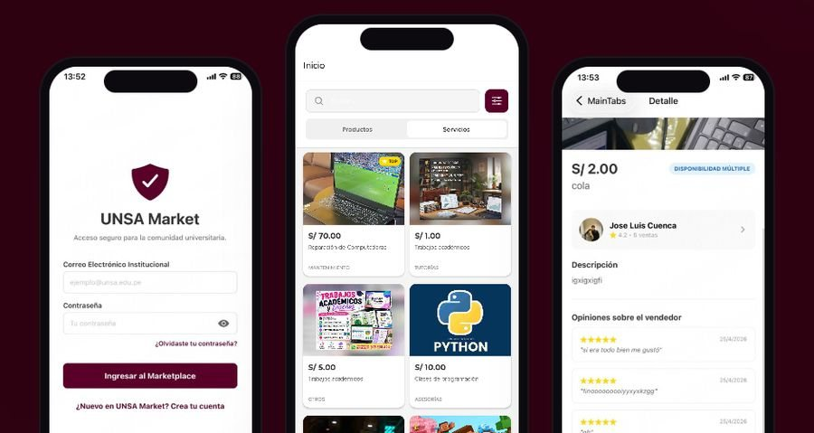

# UNSA Market

App Android para que los estudiantes de la UNSA compren, vendan y ofrezcan servicios entre ellos. La cuenta se crea con el correo institucional (@unsa.edu.pe) y cada vendedor tiene un perfil público con las reseñas de sus compradores.

Está publicada en [Google Play](https://play.google.com/store/apps/details?id=com.unsa.market). La hicimos en un equipo de cuatro para un curso de la UNSA, entre abril y julio de 2026, y yo escribí la mayor parte del código. La página de presentación está en [unsamarket.vercel.app](https://unsamarket.vercel.app/) ([código](https://github.com/JCuenca17/landing-unsa)).



## Qué se puede hacer

- Ver productos y servicios en pestañas separadas, con las publicaciones destacadas arriba.
- Publicar y editar anuncios con fotos de la galería.
- Revisar tus anuncios y tus compras.
- Calificar al vendedor después de comprarle. Las estrellas aparecen en su perfil público.
- Mirar la app como invitado, sin crear cuenta.
- Recibir notificaciones push.

## Tecnologías

React Native 0.81 con Expo SDK 54 y TypeScript. Firebase se encarga de la autenticación, Firestore guarda los datos y Storage las fotos. Las pantallas usan React Navigation, y la versión de Google Play se genera con EAS Build.

## Ejecutarlo

```
npm install
npx expo start
```

Después se escanea el código QR con Expo Go. La configuración de Firebase está en `src/services/firebaseConfig.ts`; para usar otro proyecto hay que cambiar esos valores.

## Estructura

```
src/
  navigation/AppNavigator.tsx   pestañas y pila de pantallas
  screens/                      una pantalla por archivo
  services/                     Firebase y notificaciones
  theme/theme.ts                colores y estilos compartidos
```

© 2026 José Luis Cuenca Gutiérrez. Todos los derechos reservados. Las partes hechas por el resto del equipo pertenecen a sus autores.
